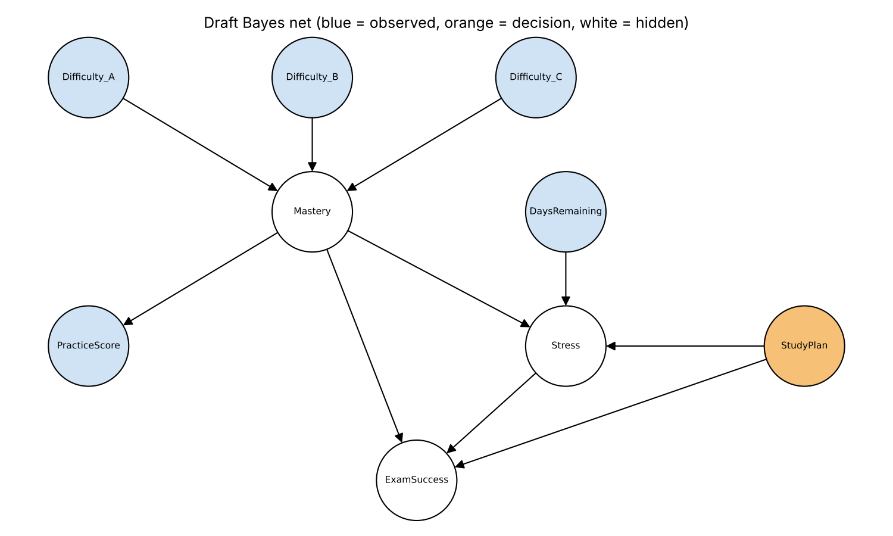

# Bayes Net - First Draft (Week 8)

This is a first pass at the structure. CPTs will be added in Week 9, and the structure might still change once I start filling them in.

## Variables

| Variable | Values | Type | Notes |
|---|---|---|---|
| Difficulty_A | Easy, Medium, Hard | Observed | Difficulty of concept A for this student |
| Difficulty_B | Easy, Medium, Hard | Observed | Difficulty of concept B |
| Difficulty_C | Easy, Medium, Hard | Observed | Difficulty of concept C |
| Mastery | Low, Medium, High | Hidden | Overall understanding of the exam material |
| PracticeScore | Low, Medium, High | Observed | Recent practice quiz / problem set results |
| DaysRemaining | Few (0-3), Some (4-7), Many (8+) | Observed | Days until the exam, from the calendar |
| StudyPlan | Intense, Light, Rest | Decision | The action the system takes today |
| Stress | Low, Medium, High | Hidden | Expected stress level |
| ExamSuccess | Pass, Fail | Hidden | Outcome we want to predict |

9 variables total, which keeps it under the ~10 limit.

## Edges and reasoning

- **Difficulty_A/B/C -> Mastery**: harder concepts make it less likely the student has mastered the material.
- **Mastery -> PracticeScore**: a student who knows the material should do better on practice questions. This gives an observation we can use to infer Mastery (upstream inference).
- **DaysRemaining -> Stress**: less time before the exam means more stress (cramming).
- **Mastery -> Stress**: students who feel unprepared are more stressed.
- **StudyPlan -> Stress**: an intense 5 hour block adds stress, a rest day lowers it.
- **Mastery -> ExamSuccess**: knowing the material is the main factor in passing.
- **StudyPlan -> ExamSuccess**: studying today raises the chance of passing.
- **Stress -> ExamSuccess**: very high stress can hurt performance.

## How the decision will work (plan)

StudyPlan is the action. For each option (Intense, Light, Rest), set it as evidence along with the observed variables, then query:

P(ExamSuccess, Stress | Difficulty_A, Difficulty_B, Difficulty_C, PracticeScore, DaysRemaining, StudyPlan)

Then use a utility function over ExamSuccess and Stress to compute the expected utility of each action and pick the highest. Utility function and actions get finalized in Week 10 after the expected utility lecture.

## Open questions

- Mastery has 3 parents with 3 values each, so its CPT has 27 rows. Might generate it from a simple scoring rule instead of writing every row by hand.
- Should DaysRemaining also point to ExamSuccess directly, or is going through Stress enough?
- Might add per-concept mastery later if there's a reason to recommend studying a specific concept.
